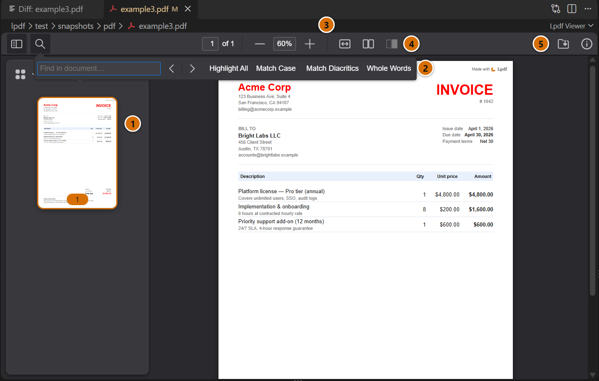
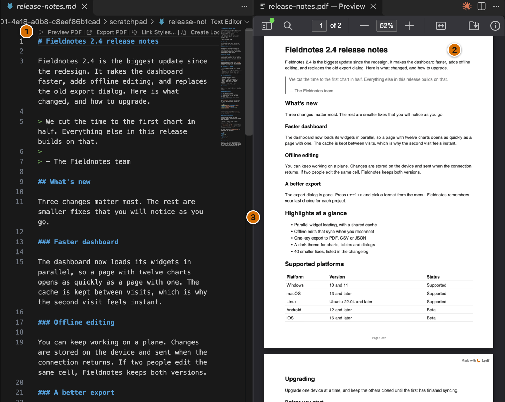
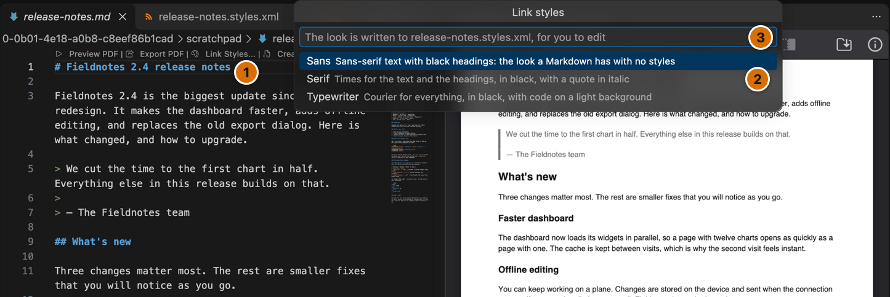
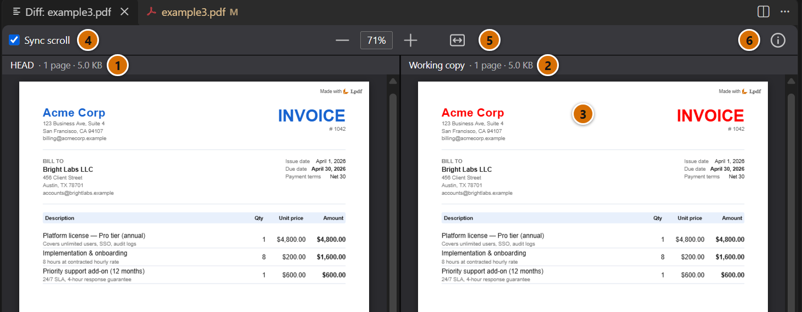
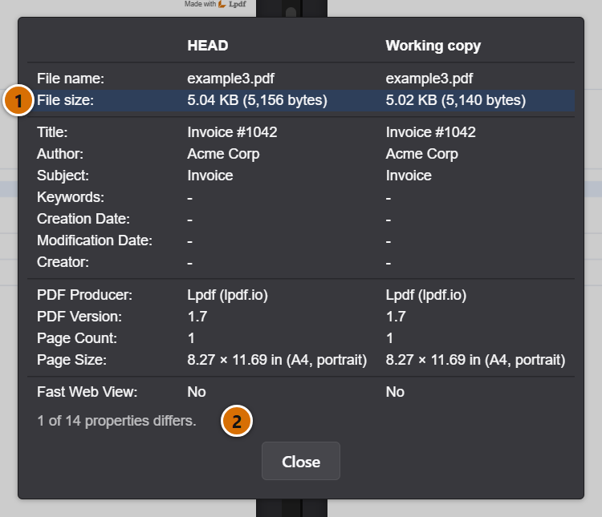
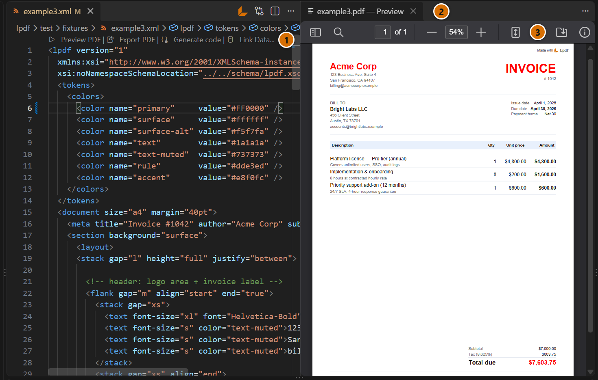
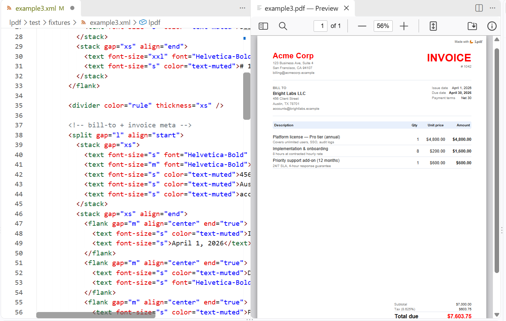
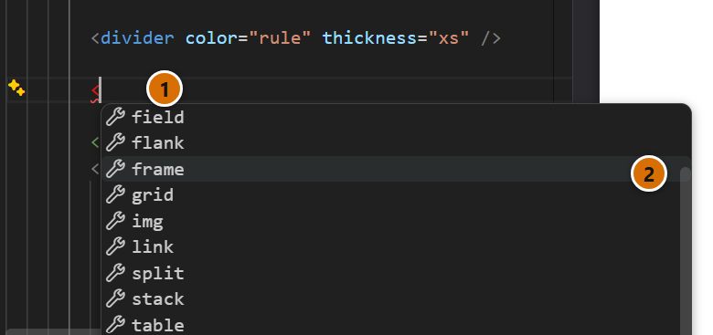
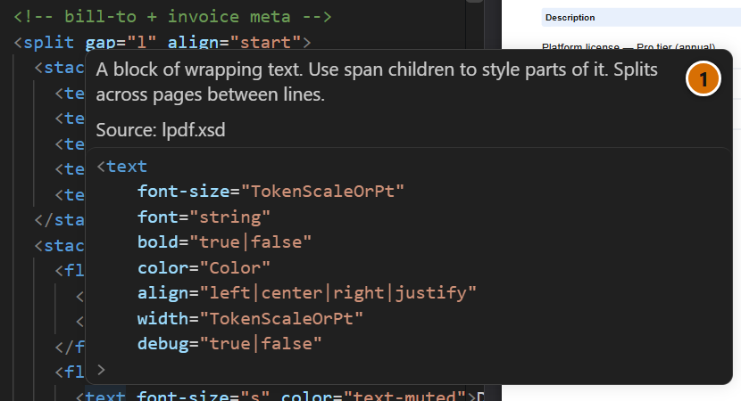
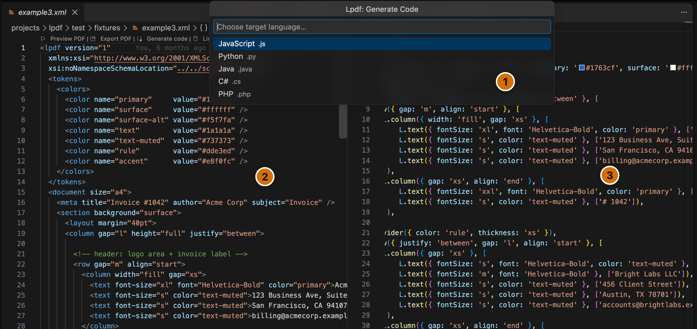

# Lpdf for VS Code

Lpdf for VS Code is a PDF viewer, a PDF preview and export for Markdown files, a visual diff for PDFs, and an editor for [Lpdf](https://lpdf.io?utm_campaign=vscode&utm_medium=referral&utm_source=readme) documents in XML with a live preview, all running on your machine.

## Preview PDF

Right-click a `.pdf` file in the Explorer and select **Lpdf: View PDF**, or use the command palette. To open every PDF this way, turn on the `lpdf.defaultPdfViewer` setting. It follows your light or dark theme.

1. Page thumbnails.
2. Text search, with highlight all, match case, diacritics and whole words.
3. Zoom by field, buttons, pinch or Ctrl and the mouse wheel, from 10% to 1000%, with a toggle between fit to width and fit to page.
4. A two-page view, with or without a cover page.
5. Save, and document properties.

## Markdown to PDF

### Preview next to the file

Right-click a `.md` file in the Explorer and choose **Lpdf: Preview PDF**, or use the button in the editor's title bar, to see it as a PDF beside it. The same commands are lenses above the first line of the file.

1. **Preview PDF**, in the lenses above the first line with Export PDF and the links below. The button in the editor's title bar does the same.
2. The PDF, set on A4 pages. It updates each time you save the `.md` file.
3. The editor and the preview scroll together, whichever you move.

### Export to PDF

Right-click a `.md` file in the Explorer and choose **Lpdf: Export PDF** to save the PDF, or use Export PDF in the lenses above the first line.

### Style the PDF

**Lpdf: Link Markdown Styles...** writes a look beside the `.md` file for you to edit, and **Lpdf: Create Lpdf Document** a page of your own around the Markdown: its size, margin, cover, header and footer.

1. **Link Styles...** in the lenses above the first line, or **Lpdf: Link Markdown Styles...**, opens the menu.
2. The looks to start from: Sans, Serif and Typewriter.
3. The file the look is written to, next to the `.md` file, for you to edit.

How styles and documents link to a `.md` file, its front matter and its images: [Markdown to PDF](https://lpdf.io/docs/vscode/?utm_campaign=vscode&utm_medium=referral&utm_source=readme#markdown-to-pdf) in the docs.

## Diff PDF

Right-click a modified PDF in the Explorer and select **Lpdf: Compare PDF with HEAD**, or choose it from the **...** menu of an open PDF's tab, to see the version in your last commit beside your working copy. **Lpdf: Compare PDF with branch...** compares with a branch or a tag instead. When you click a changed PDF in the Source Control view, Lpdf offers to open it this way.

1. **HEAD**: the PDF as of your last commit, with its page count and size. With **Compare PDF with branch...**, the branch or tag you picked.
2. **Working copy**: the file on disk.
3. What changed: here, the colour of the heading.
4. **Sync scroll**: both sides scroll together. Untick it to scroll them apart.
5. One zoom for both sides: the buttons, a typed percentage, the fit button, or a pinch.
6. The info button: a table of both documents' properties.

<table>
<tr>
<td valign="top" width="42%">

The info button opens the two documents' properties, such as size, page count and producer, in two columns.

1. A property that differs is marked.
2. How many of them differ.

</td>
<td valign="top" width="58%">

</td>
</tr>
</table>

## Author PDFs

Lpdf describes a document in XML, or in code, and renders the same PDF on every platform. This extension is where you write the XML.

### Start from a template

Run **Lpdf: New Document...**, or choose it under **File > New File...** or on a folder in the Explorer, and pick one of seven templates, from a one-page letter to a 117-page book. A template's data, fonts and images are written beside it.

### Live preview

Any `.xml` file whose root element is `<lpdf>` is an Lpdf document. Run **Lpdf: Preview PDF**, or use the buttons above `<lpdf>`, to open the rendered PDF beside your XML. It updates each time you save.

1. Buttons above the root element: preview, export, generate code, and link a data file. The **Lpdf ◆** item in the status bar opens the preview too.
2. The preview, which updates when you save.
3. The viewer's toolbar, with search, zoom, page views, save and properties.

### Autocomplete, validation and hover docs

The XML is checked against the Lpdf schema as you type.

<table>
<tr>
<td valign="top" width="58%">

</td>
<td valign="top" width="42%">

Completion offers only what the schema allows at that point.

1. Mistakes are underlined as you type: here, the unfinished tag.
2. The elements that can go inside this one.

</td>
</tr>
</table>

<table>
<tr>
<td valign="top" width="42%">

Hover an element or an attribute for what it does, the attributes it takes, and the values each accepts. The text comes from the Lpdf schema.

1. What the element is for, and where the documentation comes from.

</td>
<td valign="top" width="58%">

</td>
</tr>
</table>

### Generate code

Run **Lpdf: Generate Code** to turn the saved XML into SDK code that builds the same document. It opens beside your template.

1. Choose the language: JavaScript, Python, Java, C# or PHP.
2. Your template.
3. The code that builds the same document.

### Data, images and export

A `<name>.data.json` file next to `<name>.xml` is the document's data, or **Lpdf: Link Data File...** links another. Images and fonts load from disk. **Lpdf: Export PDF** saves the PDF, and asks for passwords when the document asks for encryption. How each works: [Author Lpdf documents](https://lpdf.io/docs/vscode/?utm_campaign=vscode&utm_medium=referral&utm_source=readme#author-lpdf-documents) in the docs.

## Works offline

The Lpdf engine, PDF viewer, and export all run locally on your machine. No server round-trips, no accounts: your documents stay on your machine. The extension collects no telemetry. The Red Hat XML extension it depends on asks for your consent to its own.

## Requirements

- [Red Hat XML](https://marketplace.visualstudio.com/items?itemName=redhat.vscode-xml), for the schema's completion and validation. It is installed with the extension, also if you only use the PDF viewer.

## Docs

[lpdf.io/docs/vscode](https://lpdf.io/docs/vscode/?utm_campaign=vscode&utm_medium=referral&utm_source=readme)

## Issues

Report bugs and request features at [github.com/lpdfio/lpdf/issues](https://github.com/lpdfio/lpdf/issues), the one tracker for the engine, the SDKs and the VS Code extension. Pull requests are not accepted.

---

Licensed under the Lpdf for VS Code License. See [LICENSE](LICENSE) for full terms.
