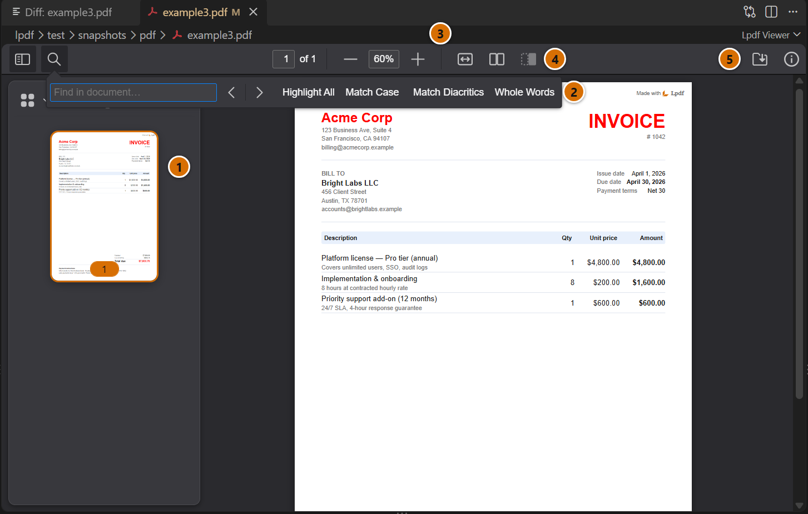
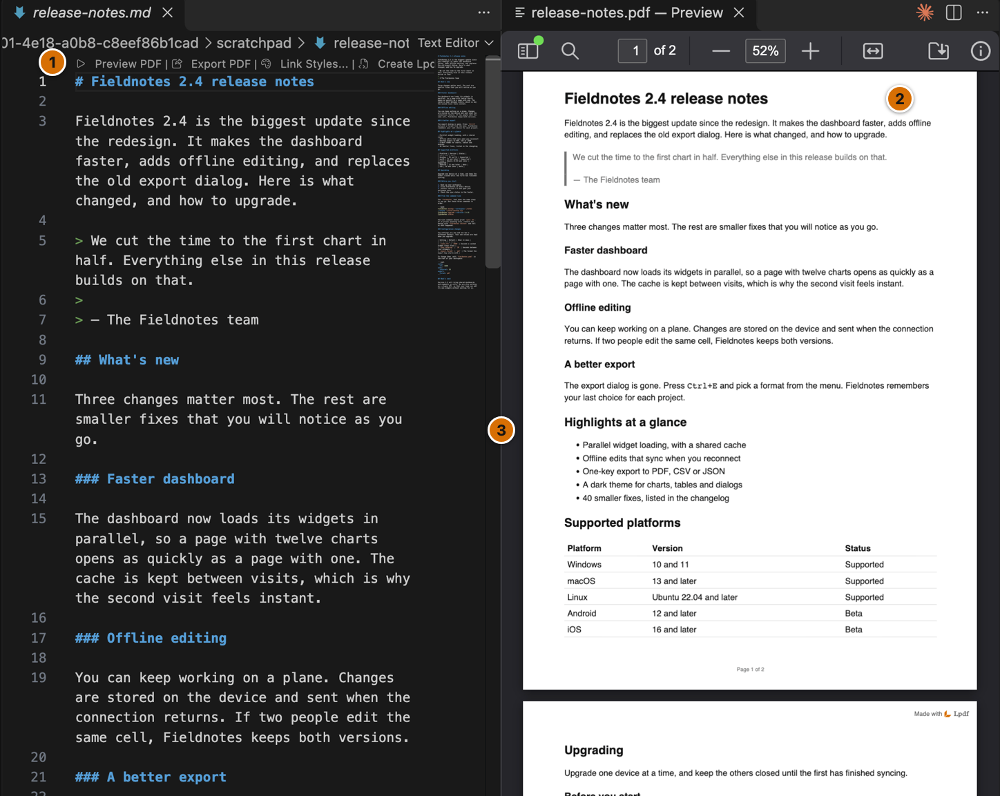
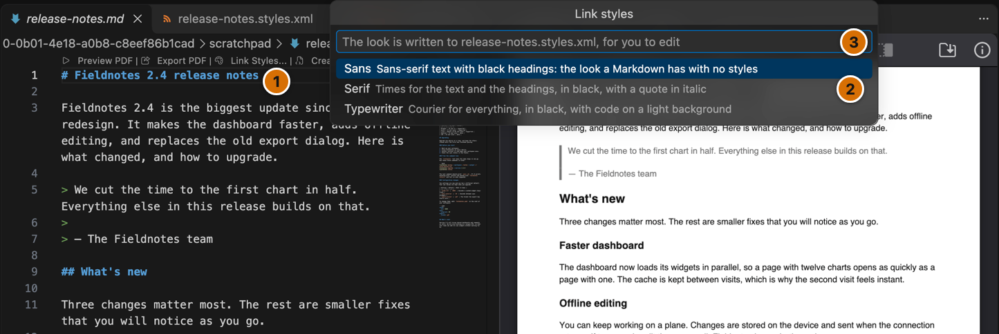
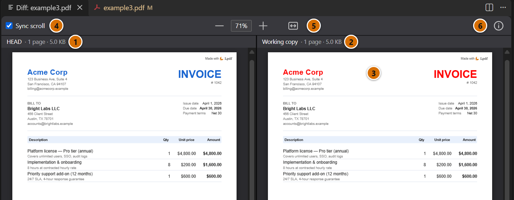
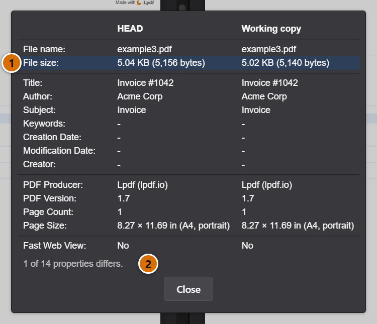
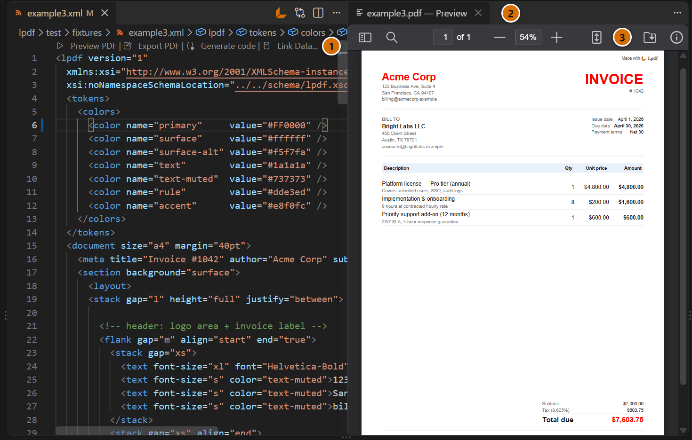
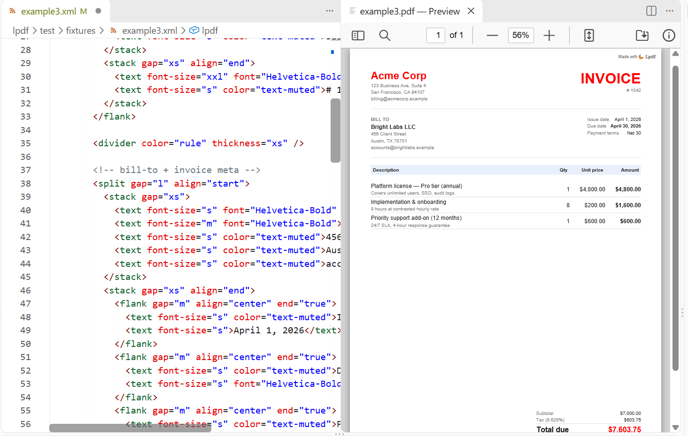
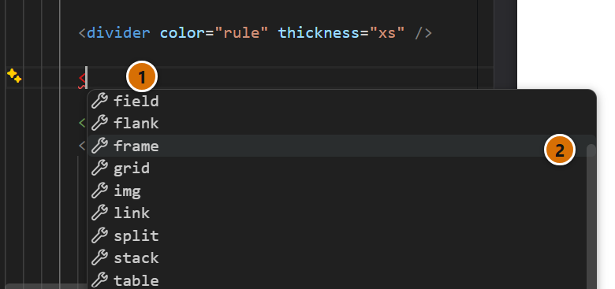
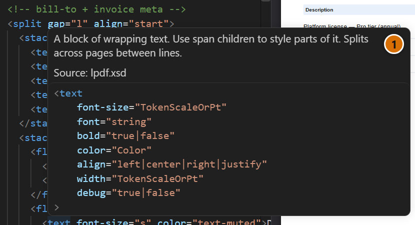
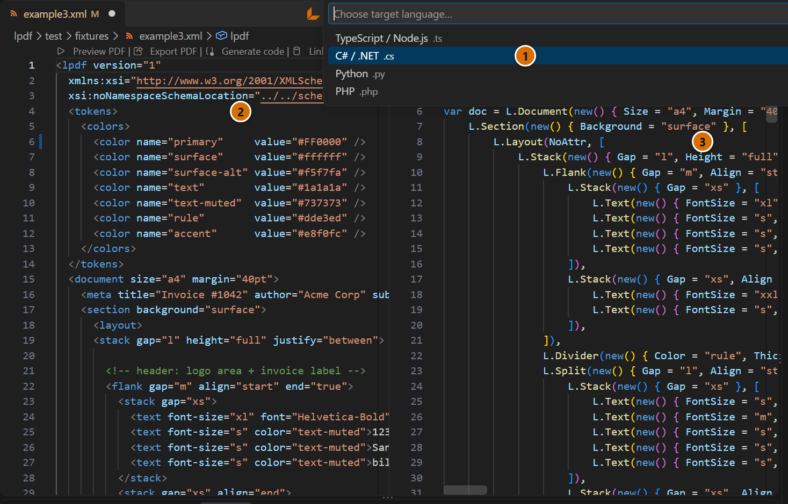

**View PDFs, preview Markdown in PDF, export Markdown to PDF, compare PDFs, and author PDFs in XML with [Lpdf](https://lpdf.io?utm_campaign=vscode&utm_medium=referral&utm_source=readme) — PDF as Code on every platform**

A PDF viewer, a PDF preview for any Markdown file, a visual diff for PDFs you have modified, and authoring tools for Lpdf: you describe a document in XML, preview it live, and turn the template into SDK code for your platform. Everything runs on your machine.

## Preview PDF

Open any `.pdf` file in VS Code: right-click it in the Explorer and select **Lpdf: View PDF**, or use the command palette. To open every PDF this way, turn on the `lpdf.defaultPdfViewer` setting. It follows your light or dark theme.

1. Page thumbnails.
2. Text search, with highlight all, match case, diacritics and whole words.
3. Zoom by field, buttons, pinch or Ctrl and the mouse wheel, from 10% to 1000%, with a toggle between fit to width and fit to page.
4. A two-page view, with or without a cover page.
5. Save, and document properties.

## Markdown to PDF

### Preview next to the file

Right-click a `.md` file in the Explorer and choose **Lpdf: Preview PDF**, or use the button in the editor's title bar, to see it as a PDF beside it. Above the first line of the file are the same commands as lenses, with the links below.

1. **Preview PDF**, in the lenses above the first line with Export PDF and the links below. The button in the editor's title bar does the same.
2. The PDF, set on A4 pages. It updates each time you save the `.md` file.
3. The editor and the preview scroll together, whichever you move.

- **Follows your edits.** The preview updates when you save the `.md` file, its Lpdf document or its styles file, and when an image changes.
- **Scrolls with the editor.** The preview and the editor agree exactly at the headings that are bookmarks in the PDF (all six levels, unless the document says otherwise with `bookmarks`), and roughly in between, most where a section holds a table, an image or a long code block. Write a heading with `#`: one underlined with `===` or `---` does not count. A file with no headings leaves both where they are.

### Export to PDF

Right-click a `.md` file in the Explorer and choose **Lpdf: Export PDF** to save the PDF, or use Export PDF in the lenses above the first line. When its Lpdf document asks for encryption, Export PDF asks for the passwords, as described under [Data, images and export](#data-images-and-export). The same file converts on the command line with `lpdf convert --input notes.md`, to the same PDF.

### Style the PDF

The file is set on an A4 page with a 54pt margin and the page number, and the default styles make headings, lists, quotes, code and tables look as people expect of rendered Markdown.

1. **Link Styles...** in the lenses above the first line, or **Lpdf: Link Markdown Styles...**, opens the menu.
2. The looks to start from: Sans, Serif and Typewriter.
3. The file the look is written to, next to the `.md` file, for you to edit.

- **Your own styles.** **Lpdf: Link Markdown Styles...** offers a look to start from: Sans (what a Markdown gets with no styles), Serif (Times) or Typewriter (Courier). It writes the look beside the `.md` file as `<name>.styles.xml`, for example `notes.styles.xml` for `notes.md`. That file is the link: a `.md` file uses the `.styles.xml` beside it with its name, and the lens above the file opens it to edit. Its rules are named after the Markdown they style (`h1`, `p`, `code`, `quote`, `li`, `table` and so on) and take the attributes of the element they become. Write only the rules you change; the rest stay as the defaults have them. Linking a look again overwrites the file, and **Lpdf: Unlink Markdown Styles** asks, then deletes it, which returns the `.md` file to the default styles.
- **Your own page.** **Lpdf: Create Lpdf Document** writes an Lpdf document named after the file, `notes.xml` for `notes.md`, beside it, links the two and opens it as a tab in the editor of the `.md` file, so that the preview stays where it is. The document is the page the Markdown is set in, an Lpdf document with a `<markdown>` in a section, so the page size, the margin, a cover, a header or a footer is XML around the Markdown. It names the styles next to the `.md` file, if there are any, and from then on it is where the styles are named. **Lpdf: Unlink Lpdf Document** goes back to the default page.
- **From the document.** An Lpdf document with a `<markdown>` has **Link Markdown...** above its first line (**Lpdf: Link Markdown File...**), which makes a `.md` file its body: the preview and the export of the document are the Markdown set in it, and the front matter is its data. A `.md` file goes with one document, and a document with one `.md` file.
- **Front matter.** A YAML block at the top of the file is not drawn. Its `key: value` lines are data the Lpdf document can show with `data-value`, for example `<text-at data-value="title">`.
- **Images.** `` is read relative to the `.md` file.

## Diff PDF

See what changed in a modified PDF. Right-click it in the Explorer and select **Lpdf: Compare PDF with HEAD**, or choose it from the **...** menu of an open PDF's tab. Click a changed PDF in the Source Control view and Lpdf offers to open it this way instead of as a text diff (switch the offer off with the `lpdf.promptPdfDiff` setting). The version in your last commit and your working copy open side by side. The file needs a committed version in a git repository.

To compare with another branch or a tag, select **Lpdf: Compare PDF with branch...** from the same menus and pick one from the list: your default branch, such as `main`, comes first, then your other branches, the remote branches and the tags. On a branch where the change is already committed, this is how you see what it changed against `main`. The left side and its column in the properties table are labelled with the branch or tag you picked.

1. **HEAD**: the PDF as of your last commit, with its page count and size. With **Compare PDF with branch...**, the branch or tag you picked.
2. **Working copy**: the file on disk.
3. What changed: here, the colour of the heading.
4. **Sync scroll**: both sides scroll together. Untick it to scroll them apart.
5. One zoom for both sides: the buttons, a typed percentage, the fit button, or a pinch.
6. The info button: a table of both documents' properties.

<table>
<tr>
<td valign="top" width="42%">

The info button opens the two documents' properties, such as size, page count and producer, in two columns.

1. A property that differs is marked.
2. How many of them differ.

</td>
<td valign="top" width="58%">

</td>
</tr>
</table>

## Author PDFs

Lpdf describes a document in XML, or in code, and renders a compact PDF that is identical on every platform. This extension is where you write the XML. Start from one of seven templates, from a one-page letter to a 117-page book, and watch the preview update each time you save. The schema checks, completes and explains your XML as you type, a JSON file supplies the data, and **Lpdf: Generate Code** turns the document into TypeScript, C#, Python or PHP.

### Start from a template

Run **Lpdf: New Document...**, or choose it under **File > New File...** or on a folder in the Explorer. Pick a template and where to save it. The templates are seven documents, from a one-page admission letter to a 117-page book: a résumé, an invoice, a report, an installment contract and a brochure are the others. A template that has data, such as the invoice and the report, writes its JSON beside the XML, and one that has fonts or images writes them to an `assets` folder next to it. The document opens with its preview beside it. Change a value in the JSON and the preview follows.

### Live preview

Any `.xml` file whose root element is `<lpdf>` is an Lpdf document, whatever it is named. Run **Lpdf: Preview PDF**, or use the buttons above `<lpdf>`, to open the rendered PDF beside your XML. It updates each time you save, and keeps your place and zoom. It is the same viewer as above, and it follows your light or dark theme.

1. Buttons above the root element: preview, export, generate code, and link a data file. The **Lpdf ◆** item in the status bar opens the preview too.
2. The preview, which updates when you save.
3. The viewer's toolbar, with search, zoom, page views, save and properties.

### Autocomplete, validation and hover docs

The XML is checked against the Lpdf schema as you type.

<table>
<tr>
<td valign="top" width="58%">

</td>
<td valign="top" width="42%">

Completion offers only what the schema allows at that point.

1. Mistakes are underlined as you type: here, the unfinished tag.
2. The elements that can go inside this one.

</td>
</tr>
</table>

<table>
<tr>
<td valign="top" width="42%">

Hover an element or an attribute for what it does, the attributes it takes, and the values each accepts. The text comes from the Lpdf schema.

1. What the element is for, and where the documentation comes from.

</td>
<td valign="top" width="58%">

</td>
</tr>
</table>

### Generate code

Run **Lpdf: Generate Code** to turn the saved XML into SDK code that builds the same document. It opens beside your template.

1. Choose the language: TypeScript, C#, Python or PHP.
2. Your template.
3. The code that builds the same document.

### Data, images and export

- **Data files.** Templates can bind to JSON data. A `<name>.data.json` file next to `<name>.xml` is picked up automatically, or choose any JSON file with **Lpdf: Link Data File...**. The preview updates when the data file changes, and export uses the same data.
- **Images and fonts.** `<image src="…">` and `` in `<assets>` load from disk. A relative path is looked up next to the XML file first, then in the root of the workspace folder. URLs are not downloaded.
- **Export.** Run **Lpdf: Export PDF** to render the current document, with its linked data, and save it to disk.
- **Encrypted export.** A document that asks for encryption in its `<output>`, as `<output encrypt="aes-256" allow="print"/>` does, is encrypted when you export it: **Lpdf: Export PDF** asks for an owner password (required) and an open password (optional: leave it empty so anyone can open the PDF and only the document's `allow` applies), each typed twice and checked against the document's cipher, then where to save. The cipher and the permissions are the document's. With AES-256 every export gets a fresh key, so the same document exported twice gives two different files. Lpdf does not store the passwords and cannot recover them. Permissions are advisory: a reader that follows the standard honors them, and a tool that does not can remove them, so use an open password when the content must stay private. The preview has no passwords: it shows such a document unencrypted, and says so.

## Works offline

The Lpdf engine, PDF viewer, and export all run locally on your machine. No server round-trips, no accounts — your documents stay private. The extension collects no telemetry. The Red Hat XML extension it depends on asks for your consent to its own.

## Requirements

- [Red Hat XML](https://marketplace.visualstudio.com/items?itemName=redhat.vscode-xml) — required for XSD autocomplete and validation. It is installed automatically, also if you only use the PDF viewer.

## Docs

[lpdf.io/docs](https://lpdf.io/docs/?utm_campaign=vscode&utm_medium=referral&utm_source=readme)

## License

The extension is free to use, for any purpose. Previews and exports carry the Lpdf attribution in the top-right corner of every page.

The PDF viewer is built on [PDF.js](https://mozilla.github.io/pdf.js/), Mozilla's open-source PDF renderer, under the Apache License 2.0, with Lpdf's own toolbar around it. It, its fonts and its other components are listed with their licenses in [THIRD_PARTY_LICENSES](THIRD_PARTY_LICENSES).

The extension code is MIT licensed. The bundled Lpdf engine may be used through the extension by anyone, including for the PDFs it produces. See [LICENSE](LICENSE) for the terms. Using the engine in your own app is covered by the [Lpdf License](https://lpdf.io/license).

Pull requests are not accepted. Report bugs and request features at [github.com/lpdfio/lpdf/issues](https://github.com/lpdfio/lpdf/issues). See [CONTRIBUTING](CONTRIBUTING.md).
